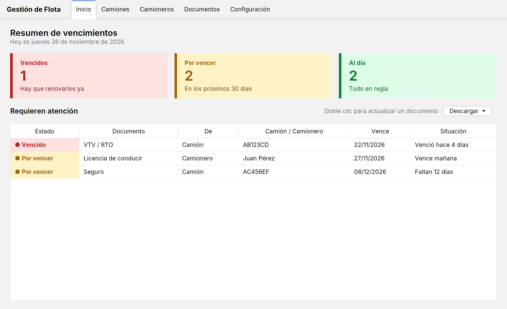
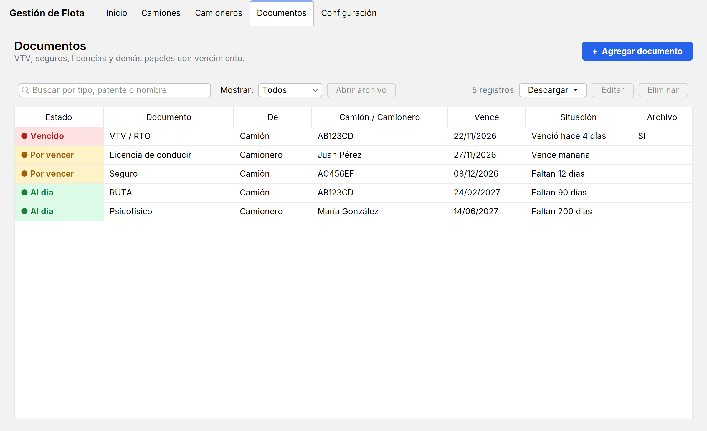
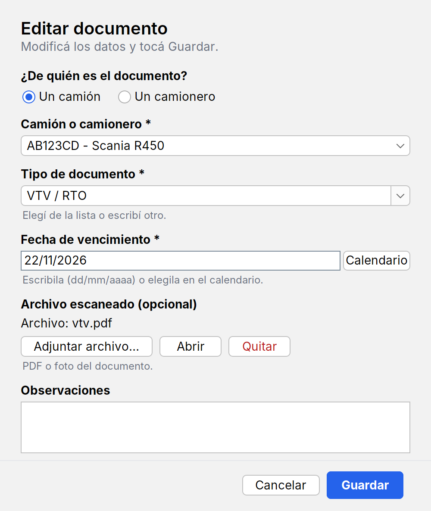
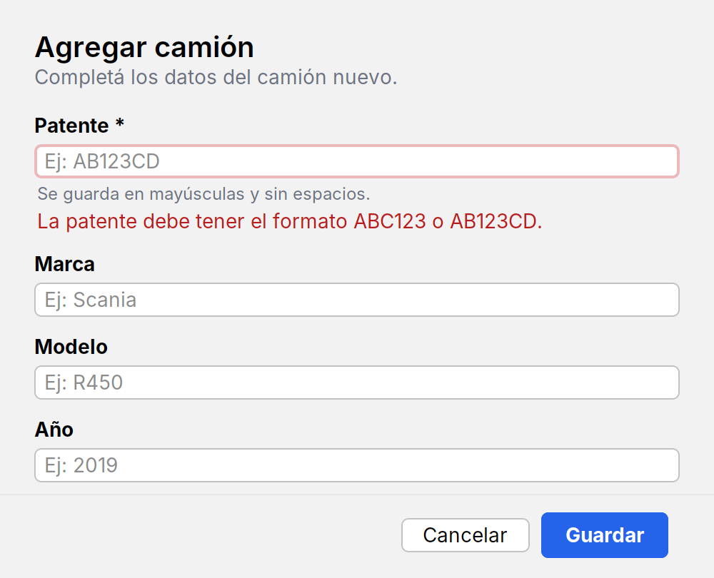
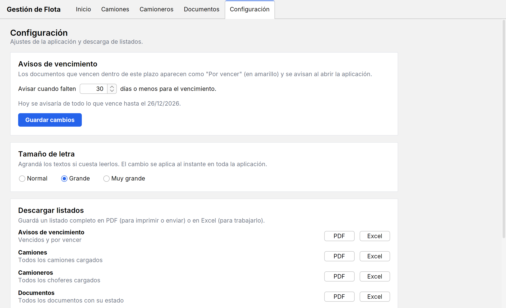
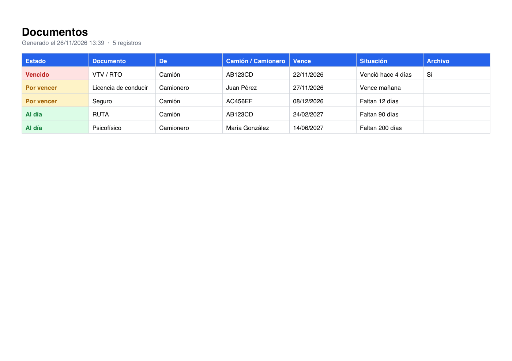

# Gestión de Flota

Aplicación de escritorio para cargar camiones, camioneros y sus documentos (VTV, seguro, licencia, psicofísico, etc.). Al abrirla avisa qué documentos están vencidos o por vencer.



## Funcionalidades
- [x] **Inicio**: resumen con los vencidos, los que vencen pronto y los que están al día. Cada tarjeta lleva al listado filtrado.
- [x] **Aviso al abrir** la app si hay documentos vencidos o por vencer.
- [x] **ABM de camiones**: la patente se valida (formato ABC123 o AB123CD) y no se puede repetir.
- [x] **ABM de camioneros**: el DNI se valida y no se puede repetir; el teléfono queda listo para WhatsApp.
- [x] **ABM de documentos**: fecha con calendario, tipos sugeridos según sea de un camión o de un camionero, archivo escaneado (PDF o foto) y observaciones.
- [x] Búsqueda en todos los listados (ignora acentos y mayúsculas) y filtro por estado en Documentos.
- [x] **Descargar en PDF o Excel**: botón *Descargar* en cada listado (baja lo que se ve, con la búsqueda y el filtro aplicados) y listados completos desde Configuración.
- [x] **Configuración**: días de anticipación para los avisos (30 por defecto, de 1 a 365), tamaño de letra (Normal, Grande, Muy grande; se aplica al instante) y carpeta de datos (se puede cambiar llevando los datos o usando una carpeta que ya tenga datos).
- [x] Se adapta a ventanas chicas y letra grande: las pestañas se desplazan, los botones pasan a otra fila y las tablas muestran barra horizontal en vez de aplastar las columnas.
- [ ] Avisos por WhatsApp (punto de extensión: `notification.Notificador`).

| Documentos | Carga de documento | Validación |
|---|---|---|
|  |  |  |

| Configuración | PDF descargado |
|---|---|
|  |  |

## Stack
- Java 21, Maven
- Swing + [FlatLaf](https://www.formdev.com/flatlaf/) (estilo moderno, con la fuente Inter incluida) + [LGoodDatePicker](https://github.com/LGoodDatePicker/LGoodDatePicker) (calendario)
- [Apache POI](https://poi.apache.org/) (Excel) y [OpenPDF](https://github.com/LibrePDF/OpenPDF) (PDF)
- SQLite (base local embebida)

## Dónde se guardan los datos
Por defecto en `~/GestionFlota`. Se puede cambiar desde **Configuración → Cambiar carpeta…** (la elección y el tamaño de letra se recuerdan en las preferencias del usuario de la computadora, no en la base). La carpeta contiene:
- `flota.db`: la base de datos (incluye la configuración).
- `documentos/`: copia de los archivos adjuntos (así no se pierden si se mueve el original).

Para pruebas se puede forzar otra carpeta con `-Dflota.datos=/ruta/a/carpeta` (tiene prioridad sobre la elegida).

## Instalar en la computadora del trabajo
Se genera una aplicación que **trae su propio Java**: los usuarios solo hacen doble clic, no instalan nada.

**Requisitos solo para quien empaqueta** (una vez, en esa computadora):
- [Git](https://git-scm.com/downloads)
- JDK 21, por ejemplo [Eclipse Temurin 21](https://adoptium.net/temurin/releases/?version=21). En el instalador de Windows marcar *Set JAVA_HOME*.
- No hace falta instalar Maven: el proyecto trae `mvnw`, que lo descarga solo.

### Windows
1. Clonar el repositorio (es privado: pide iniciar sesión en GitHub):
   ```
   git clone https://github.com/JoaqQ1/gestion-flota.git
   cd gestion-flota
   ```
2. Empaquetar:
   ```
   empaquetar-windows.bat
   ```
3. La aplicación queda en `dist\GestionFlota\GestionFlota.exe`. Crear un acceso directo en el Escritorio (clic derecho → *Enviar a* → *Escritorio*).

### macOS
```
git clone https://github.com/JoaqQ1/gestion-flota.git
cd gestion-flota
./empaquetar-mac.sh
```
Queda `dist/GestionFlota.app`; se puede arrastrar a *Aplicaciones*.

### Actualizar a una versión nueva
Cerrar la aplicación y en la carpeta del proyecto:
```
git pull
empaquetar-windows.bat
```
Los datos **no se pierden**: están en la carpeta de datos (por defecto `C:\Users\<usuario>\GestionFlota`), separada del programa.

### Datos y varios usuarios
- Cada usuario de Windows tiene su propia carpeta de datos. Para que todos vean los mismos datos en esa computadora, elegir la misma carpeta en *Configuración → Cambiar carpeta…* (por ejemplo `C:\GestionFlota`).
- Evitar que dos personas usen la **misma** carpeta de datos al mismo tiempo desde **distintas computadoras** (por ejemplo, en una carpeta de red): la base SQLite no está pensada para eso.
- Copia de seguridad: copiar la carpeta de datos completa.

## Desarrollo
```bash
./mvnw compile exec:java     # ejecutar
./mvnw test                  # tests
./mvnw package               # genera target/gestion-flota.jar (requiere Java 21 para correrlo)
```

## Estructura
Organizado por módulo; cada uno con `model`, `repository`, `service` y `ui`:
```
com.flota
├── camion         Camiones
├── camionero      Camioneros
├── documento      Documentos, estados de vencimiento y archivos adjuntos
├── alerta         Búsqueda de vencimientos para avisar
├── exportacion    Generación de PDF y Excel
├── notification   Canales de aviso (WhatsApp a futuro)
├── common         Validaciones y utilidades de texto
├── config         Configuración guardada (días de aviso) y carpeta de datos
├── repository     Conexión y esquema de SQLite
└── ui             Ventana principal, Inicio y componentes comunes (listado, formulario, estilos)
```
